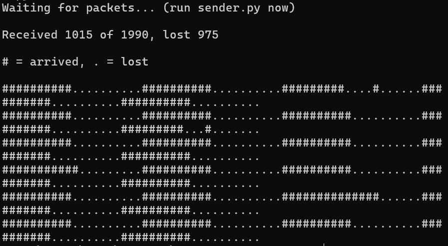
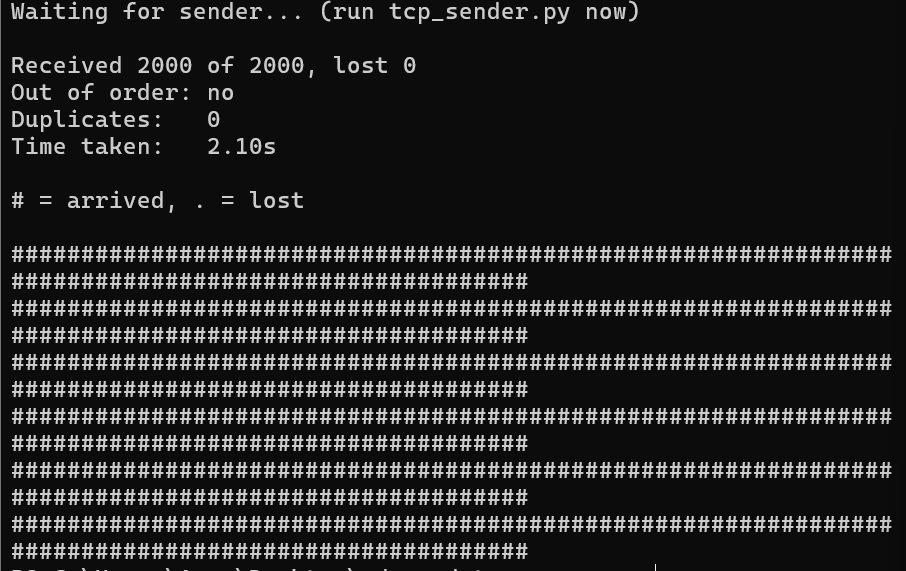

<p align="center">
  
</p>


# UDP vs TCP Packet Loss Demo

A tiny Python experiment that lets you **see UDP packet loss with your own eyes**, then runs the exact same test over TCP to show the difference.

A sender fires numbered packets at a receiver whose socket buffer is deliberately small and whose processing is deliberately slow. Over **UDP**, the buffer overflows and the OS silently drops packets. Over **TCP**, flow control slows the sender down and nothing is lost. The receiver prints a map of exactly which packets arrived and which vanished.

No external dependencies. Pure Python standard library.

---

## Results at a glance

| | UDP | TCP |
|---|---|---|
| Packets received | 1031 of 1990 | 2000 of 2000 |
| Packets lost | 959 | 0 |
| Out of order | possible | never |
| Sender behavior | never waits, never told about loss | blocked until the receiver has room |

> UDP numbers come from a real run on Windows (`TOTAL = 2000`, `BURST = 20`). Your numbers will differ. TCP should always show zero loss.

### UDP: packets silently dropped

<p align="center">
  
</p>


### TCP: nothing lost

<p align="center">
  
</p>


---

## Why this exists

UDP is *connectionless* and *unreliable*: it never retransmits, never reorders, and never tells the sender that a packet was dropped. TCP is the opposite: ordered, reliable, and flow-controlled. That's easy to read about and hard to feel.

On localhost the OS rarely drops anything, so this demo **forces** overflow by shrinking the receiver's buffer and slowing it down, then uses sequence numbers to prove what happened.

## How it works

1. The **sender** transmits packets in bursts. Each packet starts with an 8-digit sequence number (`00000042` + filler bytes), then pauses briefly between bursts.
2. The **receiver** uses a very small receive buffer (`SO_RCVBUF = 8192`) and busy-waits after each packet to simulate a slow consumer.
3. **UDP:** packets arriving while the buffer is full are discarded by the OS. Nothing raises an error on either side.
4. **TCP:** when the buffer fills, flow control tells the sender to stop. `sendall()` blocks until there's room, so the sender slows down instead of data being dropped.
5. The receiver compares the sequence numbers it saw against the range it expected and prints a summary plus a visual strip.

## Requirements

- Python 3.8+
- Any OS (tested on Windows; behavior on Linux/macOS will differ, see [Notes](#notes-and-limitations))

## Usage

Open two terminals in the project folder. Always start the **receiver first**.

### UDP test

```bash
# Terminal 1
python receiver.py

# Terminal 2
python sender.py
```

Wait about 3 seconds after the sender finishes. The receiver stops after 3 seconds of silence and prints its report.

### TCP test

```bash
# Terminal 1
python tcp_receiver.py

# Terminal 2
python tcp_sender.py
```

The receiver prints its report as soon as the sender finishes.

## Tuning the experiment

| Setting | Files | Effect |
|---|---|---|
| `BURST` | `sender.py`, `tcp_sender.py` | Packets sent back-to-back. For UDP, higher means more loss; `1` means almost none. For TCP, it only changes how long the test takes. |
| `TOTAL` | `sender.py`, `tcp_sender.py` | Total packets to send. |
| `SO_RCVBUF` | `receiver.py`, `tcp_receiver.py` | Receive buffer size. Smaller means more UDP loss. |
| `slow_down(...)` | `receiver.py`, `tcp_receiver.py` | Per-packet delay. Larger means more UDP loss. |

**Want to see zero UDP loss?** Set `BURST = 1` or add a small `time.sleep(0.001)` between every packet in `sender.py`. The receiver keeps up and nothing is dropped.

## Project structure

```
.
├── assets/
│   ├── banner.jpg         # README banner
│   ├── udp_result.png     # screenshot of the UDP run
│   └── tcp_result.png     # screenshot of the TCP run
├── sender.py              # UDP: sends numbered packets in bursts
├── receiver.py            # UDP: receives, tracks sequence numbers, prints loss map
├── tcp_sender.py          # TCP: same test over a TCP connection
├── tcp_receiver.py        # TCP: same slow receiver, reads fixed-size packets
└── README.md
```

## Notes and limitations

This is an **educational demo, not a benchmark**. Please don't read it as a measurement of how UDP or TCP behave on the internet.

- **Loss is engineered.** UDP loss comes from an intentionally tiny buffer and a slow receiver on loopback, not from real network conditions such as congested routers or Wi-Fi interference. Don't treat the loss percentage as typical UDP behavior.
- **TCP's retransmission isn't exercised.** Loopback never drops packets in transit, so this test shows TCP *preventing* overflow loss through flow control, not *repairing* network loss. To see retransmission, inject loss with [`clumsy`](https://jagt.github.io/clumsy/) (Windows) or `tc netem` (Linux).
- **Results vary by machine.** Buffer behavior, CPU speed, and timer resolution all change the numbers. Linux may also adjust `SO_RCVBUF` from the value you request.
- **UDP tail loss is invisible.** The receiver only knows about packets up to the highest sequence number it saw, so packets lost at the very end aren't counted (that's why the UDP example shows 1990 expected instead of 2000).
- **Single run.** For meaningful numbers, run each test several times and report the range.
- **UDP duplicates and reordering are not checked** in the UDP receiver, though both can happen on real networks.

## What you should take away

- UDP drops packets **silently** when the receiver can't keep up. The sender never finds out.
- TCP's flow control throttles the sender instead, so nothing is lost, at the cost of speed.
- If you use UDP and need reliability, you have to build it yourself (sequence numbers, ACKs, retransmits). With TCP, the protocol does it for you.

## License

MIT. Use it, tweak it, teach with it.
